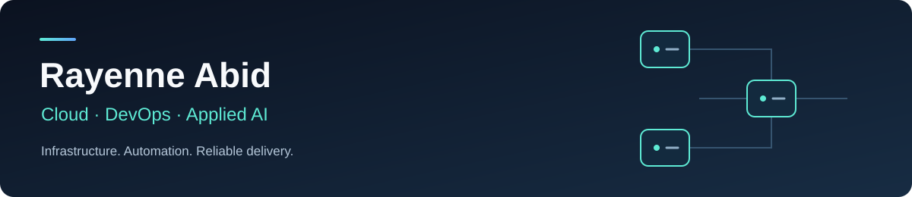

Final-year engineering student at **INSAT**  
**Certified Kubernetes Administrator (CKA)** · **AWS Certified Cloud Practitioner**

[LinkedIn](https://www.linkedin.com/in/rayenneabid/) · [Email](mailto:abidrayenne2002@gmail.com)

**Available from February 2027 for a 4–6-month final-year internship**

---

## About me

I work at the intersection of cloud infrastructure, delivery automation, and applied AI. My experience includes AI-assisted Kubernetes security reviews at TALAN, containerized application delivery at Nomow, and AWS cloud migration at Poulina Group Holding.

I'm interested in **DevOps, DevSecOps, Platform Engineering, SRE, and applied AI for engineering workflows**. I focus on reproducible infrastructure, useful observability, and automation that keeps engineers in control.

## Featured projects

| Project | What it demonstrates | Core technologies |
| :--- | :--- | :--- |
| **[OpsPilot](https://github.com/Rayenne10/opspilot)** | Kubernetes incident investigation with runbook retrieval, cited evidence, and engineer-reviewed recommendations. | Python · FastAPI · OpenAI · Qdrant · Kubernetes |
| **[ECS Fargate Platform](https://github.com/Rayenne10/ecs-fargate-platform)** | Terraform-managed AWS deployment with OIDC authentication, container releases, and rollout verification. | AWS · Terraform · GitHub Actions · Docker |
| **[Velora](https://github.com/Rayenne10/velora)** | Observability and security checks for a microservices application, including traces, metrics, and failure/recovery alerts. | OpenTelemetry · Prometheus · Jaeger · Docker · Kubernetes |
| **[AI-assisted DevSecOps](https://github.com/Rayenne10/devsecops-talan)** | Parallel Kubernetes scanning, structured AI review, and proposed remediation through human-reviewed draft merge requests. | Jenkins · Python · OpenAI · GitLab · FluxCD |

## Tools I work with

- **Cloud & infrastructure:** AWS, Terraform, Linux, Vagrant
- **Containers & orchestration:** Docker, Docker Compose, Kubernetes, k3s
- **Delivery & GitOps:** GitHub Actions, Jenkins, Git, FluxCD
- **Security:** Trivy, kube-linter, kube-score
- **Observability:** Prometheus, Grafana, OpenTelemetry, Jaeger, Elasticsearch
- **Applied AI & development:** Python, Bash, OpenAI APIs, RAG, FastAPI, Qdrant

## Let's connect

I'm looking for a **4–6-month final-year internship starting in February 2027**, where I can contribute to cloud platforms, reliable delivery, or AI-assisted engineering tools.

[Connect on LinkedIn](https://www.linkedin.com/in/rayenneabid/) or [email me](mailto:abidrayenne2002@gmail.com).
